<p align="center">
  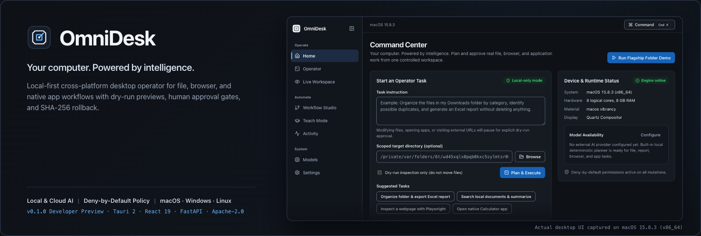
</p>

# OmniDesk

**Your computer. Powered by intelligence.**

OmniDesk is an independent, local-first, cross-platform desktop application that converts natural-language instructions and explicit user demonstrations into verified, permission-gated computer operations across macOS, Windows, and Linux.

Currently available as an early-stage **Developer Preview (`v0.1.0`)** built from source. OmniDesk runs a native Tauri 2 shell in Rust, a React 19 interface styled with the Omni Glass design system, and a local Python operator engine communicating strictly over authenticated loopback IPC (`127.0.0.1`).

[Features](#core-features) · [Screenshots](#application-screenshots) · [Architecture](#system-architecture) · [AI Providers](#local-ai-and-cloud-providers) · [Installation](#installation) · [Platform Support](#platform-compatibility-matrix) · [Security & Privacy](#security-and-privacy-architecture) · [Roadmap](#development-roadmap)

---

## Overview

Most automation tools ask users to choose between brittle scripts and unconstrained agents that execute shell commands without review. OmniDesk separates planning from execution:

1. An AI model (local Ollama by default, or an opt-in cloud provider) generates a typed JSON plan rather than raw shell text.
2. Outside-the-model validation checks every tool name and parameter against a deny-by-default policy registry. If a model emits an invalid plan or is unreachable, OmniDesk switches transparently to its built-in deterministic local planner.
3. Read-only inspection within an approved directory runs immediately. Any file modification, report export, application launch, semantic UI action, or external URL request pauses with a dry-run preview until you explicitly approve it.
4. File moves record SHA-256 checksums in a local SQLite operation journal so you can roll back completed moves from the Operator or Activity views.

---

## Application Screenshots

The screenshots below were captured from the running OmniDesk desktop application on macOS 15.8.3 (`x86_64`) using an isolated temporary demo folder (`flagship-downloads-demo`).

### Command Center (Dark and Light Omni Glass)

<table>
  <tr>
    <td width="50%">
      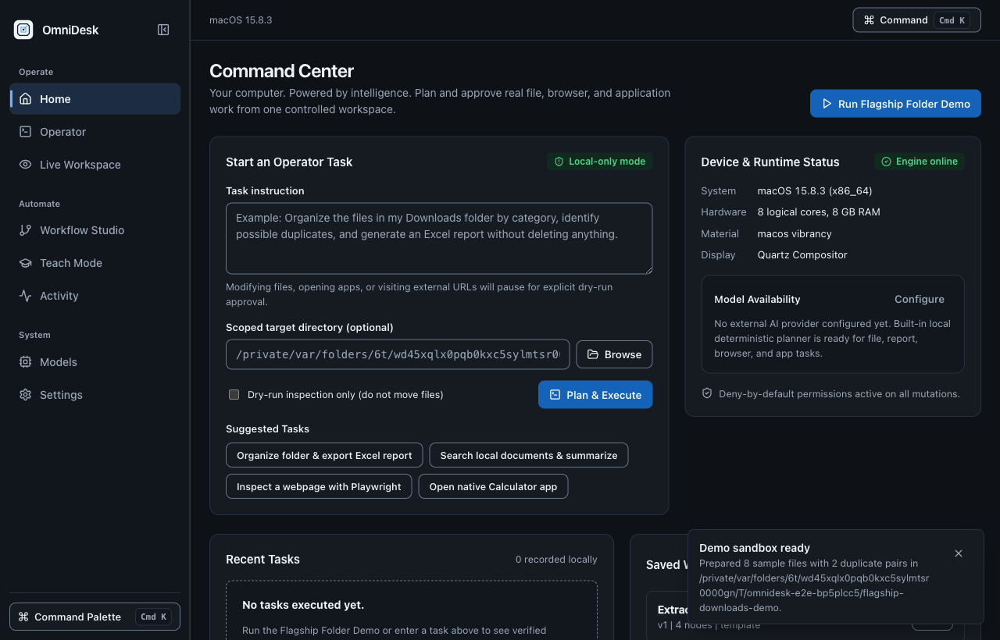
      <p align="center"><sub>Dark Omni Glass theme with local-only status, scoped directory controls, and live runtime telemetry.</sub></p>
    </td>
    <td width="50%">
      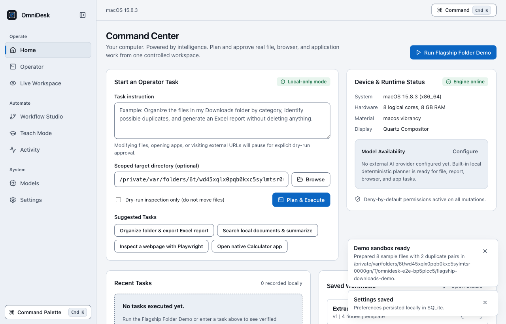
      <p align="center"><sub>Light Omni Glass theme verified to WCAG AA contrast standards.</sub></p>
    </td>
  </tr>
</table>

### Operator Dry-Run Approval Gate

<p align="center">
  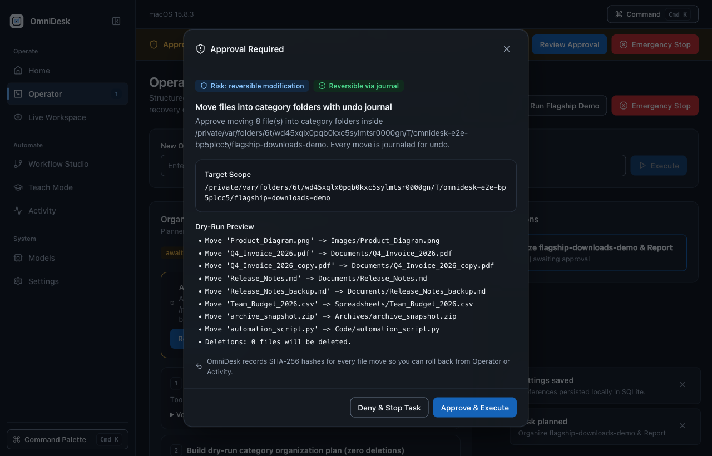
</p>

Before moving files or interacting with external applications, OmniDesk displays the classified risk tier, reversibility status, exact target scope, and line-by-line dry-run preview with a zero-deletion guarantee.

### Workflow Studio and Teach Mode

<table>
  <tr>
    <td width="50%">
      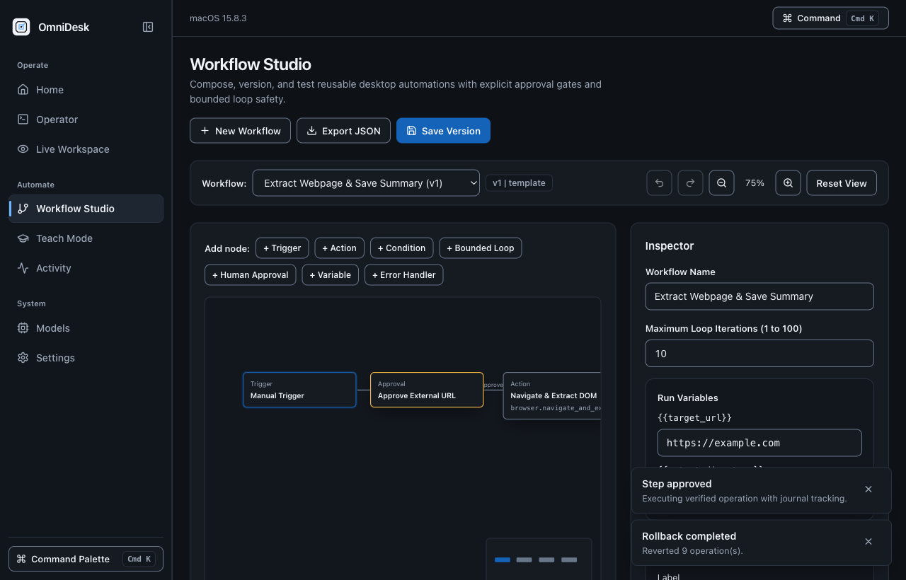
      <p align="center"><sub>Workflow Studio node canvas with approval gates, minimap, zoom controls, and bounded loop configuration (capped at 100 iterations).</sub></p>
    </td>
    <td width="50%">
      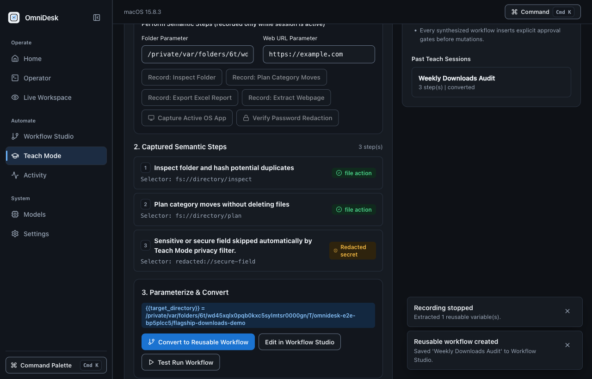
      <p align="center"><sub>Teach Mode recording semantic steps, automatically redacting secure fields, and extracting reusable workflow variables.</sub></p>
    </td>
  </tr>
</table>

*Note: Additional views introduced during `v0.1.0` development (including Models and Settings) will be added in a future documentation update.*

---

## Core Features

### Natural-Language Command Center and Operator Timeline

Submit tasks in plain English from the Command Center, the `Cmd/Ctrl+K` Command Palette, the system tray, or the global `CommandOrControl+Shift+Space` shortcut. The Operator view tracks each planned step, verification outcome, planner fallback notice, active approval request, and one-click Emergency Stop control. Two built-in walkthroughs, the Flagship Folder Demo and External App Demo, let you test scoped automation in an isolated sandbox before pointing OmniDesk at real folders.

### Scoped Folder Organization and Excel Reporting

OmniDesk inspects scoped directories, groups candidate duplicates by byte size before confirming exact matches with SHA-256 content hashes, previews every proposed category move, preserves a zero-deletion guarantee, logs each move into a SHA-256-verified rollback journal, and generates formatted multi-sheet `.xlsx` workbooks with OpenPyXL.

### Workflow Studio

Build, version, dry-run, and replay directed acyclic graph (DAG) automations stored locally in SQLite (`omnidesk.db`). Workflow Studio supports pan, zoom, a live minimap, pointer and keyboard node positioning, undo/redo history, portable JSON export, human approval gates on mutating nodes, and bounded loops strictly capped at 100 iterations in both Zod and Pydantic schemas.

### Teach Mode

Record repeatable desktop procedures explicitly without silent background monitoring. Recording starts only when you click **Start Teaching** and displays a persistent top **Teach Mode Recording** banner with an immediate stop button. OmniDesk captures scoped semantic steps (file operations, permitted active-window transitions, browser steps, and accessibility actions), drops password fields and excluded sensitive apps automatically, lets you prune individual steps, extracts reusable parameters, and saves a versioned workflow into Workflow Studio.

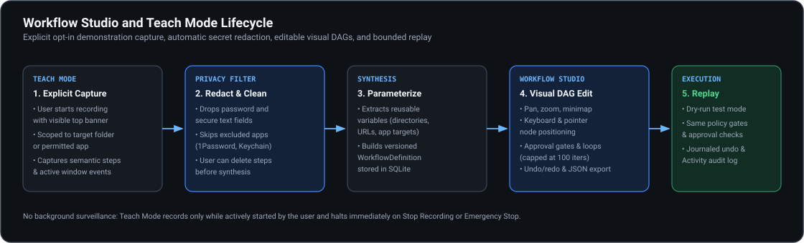

See [docs/WORKFLOWS.md](docs/WORKFLOWS.md) for authoring details and current semantic replay boundaries.

### Playwright Browser Automation

Navigate web pages, extract structured DOM content and links, and prepare web forms using Playwright Chromium. All extracted page content is treated as untrusted data and isolated from planner instructions to reduce prompt-injection risk. External URL navigation requires explicit approval, and OmniDesk never submits external forms automatically.

### Native Desktop Accessibility and App Control

Discover running applications, inspect native accessibility trees, focus windows, launch applications, and run approved semantic interactions through isolated OS adapters (`AXIsProcessTrusted` and System Events on macOS, `UIAutomationClient` and Win32 `User32` on Windows, and `AT-SPI2` plus D-Bus XDG Desktop Portals on Linux). A Floating Assistant panel keeps quick commands accessible alongside active apps.

### Omni Glass Design System and MCP Interoperability

OmniDesk uses a four-tier material hierarchy that adapts to each host operating system: `NSVisualEffectView` vibrancy on macOS, Mica on Windows 11, Acrylic on Windows 10, and compositor blur or solid surfaces on Linux. Both Light and Dark themes pass WCAG AA contrast verification (see [DESIGN.md](DESIGN.md)), respect `prefers-reduced-motion`, and include a Performance Mode that disables blur filters on Intel and lower-powered machines. The local engine also exposes a Model Context Protocol (MCP) JSON-RPC 2.0 endpoint at `/mcp` for structured tool interoperability.

---

## System Architecture

OmniDesk isolates the native desktop shell, frontend workspace, shared validation schemas, local operator engine, and AI inference backends across distinct process boundaries.

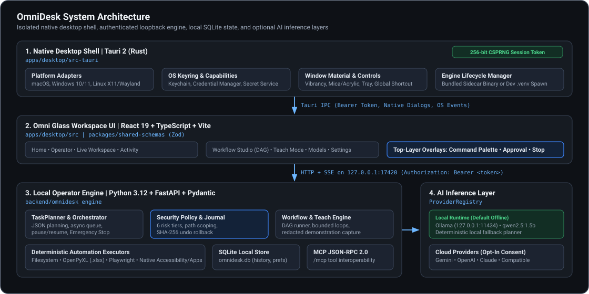

Every request moves through a seven-stage execution state machine that keeps planning separate from execution and puts policy validation outside the language model:

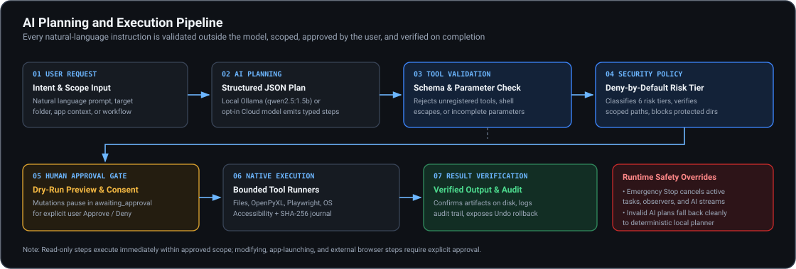

In development mode (`pnpm dev:desktop`), the Rust shell spawns `backend/.venv/bin/python`. In packaged release builds (`scripts/build-sidecar.py` with `tauri.release.conf.json`), Tauri launches a bundled PyInstaller sidecar binary (`omnidesk-engine`) directly so end users do not need Python, `uv`, Rust, or Node.js installed.

Full module layout and IPC specifications are documented in [docs/ARCHITECTURE.md](docs/ARCHITECTURE.md).

---

## Local AI and Cloud Providers

OmniDesk routes model requests through a privacy-aware `ProviderRegistry` (`backend/omnidesk_engine/providers/registry.py`) that enforces **Local-only** privacy mode by default.

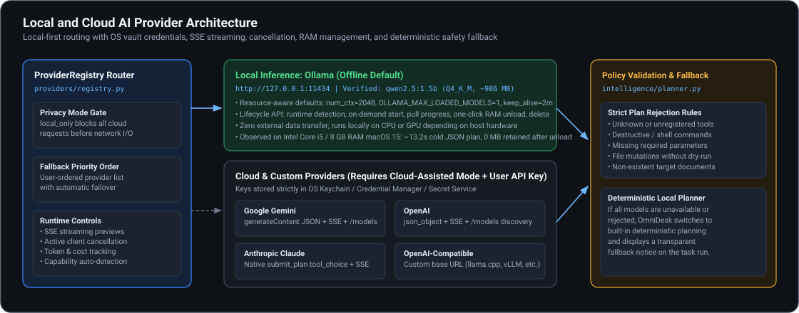

### Local Inference with Ollama (Offline Default)

Local planning runs completely offline against Ollama on `http://127.0.0.1:11434`. Inside the **Models** view, OmniDesk detects installed Ollama binaries automatically, starts the local daemon on demand, pulls models with live progress updates, configures context window size (`num_ctx=2048` by default on systems with `<= 9 GB` RAM, `4096` on higher-RAM hosts), enforces `OLLAMA_MAX_LOADED_MODELS=1` and `OLLAMA_KEEP_ALIVE=2m`, and provides a one-click **Unload from RAM** action (`keep_alive: 0`).

| Verified Local Setup | Observed Development Configuration |
| --- | --- |
| Runtime | Ollama `v0.40.17` (universal macOS binary) |
| Model | `qwen2.5:1.5b` (1.5B parameters, GGUF `Q4_K_M`, ~986 MB on disk) |
| Test Hardware | macOS 15.8.3, Intel Core i5-8279U (`x86_64`, 8 logical cores), 8 GB RAM |
| Observed Behavior | ~13.2s cold structured JSON plan (277 tokens); warm streaming responses; 0 MB model RAM retained after unload |

*Timing above reflects CPU inference on one 8 GB Intel macOS laptop and is not a universal benchmark across other hardware.*

Compact 0.5B to 1.5B quantized models fit inside 8 GB RAM without a discrete GPU, though they omit required tool parameters more often than larger cloud models on multi-step prompts. OmniDesk addresses this structurally by validating every AI-produced plan outside the model and falling back to `local_deterministic_planner` with a visible notice whenever a plan is malformed or violates policy.

### Optional Cloud AI Providers

Cloud inference is disabled in **Local-only** mode before any outbound socket opens. When you add an API key to your OS credential vault and explicitly switch **Settings > Privacy Mode** to **Cloud-assisted**, OmniDesk supports four remote adapters with user-ordered fallback priority, live SSE streaming previews, active cancellation, and token/cost estimates:

| Provider | Structured Plan Format | Model Discovery | Streaming and Abort |
| --- | --- | --- | --- |
| Google Gemini | `generateContent` with `systemInstruction` and `responseMimeType: application/json` | `GET /v1beta/models` | SSE (`streamGenerateContent?alt=sse`) |
| OpenAI | `/chat/completions` with `response_format: json_object` | `GET /v1/models` | SSE stream |
| Anthropic Claude | `/messages` with native `submit_plan` tool schema and `tool_choice` | `GET /v1/models` | SSE (`content_block_delta`) |
| OpenAI-Compatible | `/chat/completions` against a custom base URL (llama.cpp, vLLM, LM Studio) | `GET /models` | SSE stream |

Full provider configuration details live in [docs/AI_PROVIDERS.md](docs/AI_PROVIDERS.md).

---

## Technology Stack

| Layer | Technologies | Repository Location |
| --- | --- | --- |
| Native Desktop Shell | Rust (Edition 2021), Tauri 2, `window-vibrancy`, `keyring`, `sysinfo`, Tauri dialog, notification, and global-shortcut plugins | `apps/desktop/src-tauri` |
| Desktop Frontend | React 19, TypeScript 5.7, Vite 6, Omni Glass 4-tier CSS tokens, `lucide-react`, Vitest, Testing Library | `apps/desktop/src` |
| Shared Contracts | TypeScript, Zod 3 | `packages/shared-schemas` |
| Local Operator Engine | Python 3.11 to 3.13 (`uv`), FastAPI, Uvicorn, Pydantic v2, SQLite (`omnidesk.db`), HTTPX, OpenPyXL, Pillow, `psutil`, Playwright | `backend/omnidesk_engine` |
| Bundling and CI | PyInstaller standalone sidecar bundler, GitHub Actions 6-target native build matrix | `scripts/build-sidecar.py`, `.github/workflows/ci.yml` |

---

## Installation

OmniDesk `v0.1.0` is currently installed and run from source as a Developer Preview. Signed and notarized public desktop installers have not been published yet.

### Prerequisites

- Node.js `20+` and `pnpm 9+`
- Python `3.11` to `3.13` and `uv`
- Stable Rust toolchain (`rustup` and `cargo`)
- On Ubuntu/Debian Linux: `libwebkit2gtk-4.1-dev`, `libappindicator3-dev`, `librsvg2-dev`, `patchelf`, `libsecret-1-dev`, and `libatspi2.0-dev`

### Setup and Launch

1. Clone the repository and install workspace dependencies:

```bash
git clone https://github.com/dandisetiawanco/Omnidesk.git
cd Omnidesk
pnpm install
```

2. Provision the Python operator engine virtual environment and install Chromium for Playwright browser tasks:

```bash
uv sync --directory backend --python 3.12 --extra dev
backend/.venv/bin/playwright install chromium
```

3. Launch the native desktop application in development mode:

```bash
pnpm dev:desktop
```

4. Optional offline AI setup with Ollama (install Ollama from [ollama.com/download](https://ollama.com/download)):

```bash
ollama pull qwen2.5:1.5b
```

Open the **Models** view inside OmniDesk to detect Ollama automatically, start the local service on demand, run a live streaming check, or unload the model from RAM when idle.

### Optional Verification and Release Sidecar Build

Run the workspace verification suites:

```bash
pnpm typecheck
pnpm test:schemas
pnpm test:web
PYTHONPATH=backend backend/.venv/bin/pytest backend/tests -v
cargo test --manifest-path apps/desktop/src-tauri/Cargo.toml
```

Build a standalone local sidecar and native desktop bundle on your current host OS:

```bash
uv sync --directory backend --python 3.12 --extra bundle
backend/.venv/bin/python scripts/build-sidecar.py
pnpm --filter @omnidesk/desktop tauri build --config src-tauri/tauri.release.conf.json
```

See [docs/INSTALLATION.md](docs/INSTALLATION.md) for platform permissions setup and [docs/TROUBLESHOOTING.md](docs/TROUBLESHOOTING.md) for runtime diagnostics.

---

## Platform Compatibility Matrix

OmniDesk isolates host OS code behind the Rust `PlatformAdapter` trait (`apps/desktop/src-tauri/src/platform/`) and Python OS branches (`backend/omnidesk_engine/automation/desktop_control.py` and `capabilities.py`). The matrix below separates what has been verified locally on real hardware from adapters that are implemented and configured in CI pending native host testing.

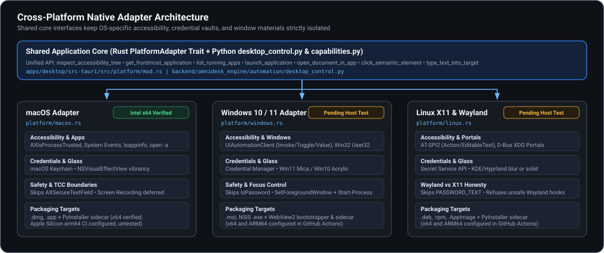

| Platform | Architecture | Packaging Targets | Runtime Status | Native Glass Material |
| --- | --- | --- | --- | --- |
| macOS 13+ (tested on 15.8.3) | Intel `x86_64` | `.dmg`, `.app` + sidecar | Verified locally on hardware (Tauri 2 shell, Python engine, Ollama `qwen2.5:1.5b`, Accessibility tree, Keychain, Playwright, Flagship Demo) | `NSVisualEffectView` (`UnderWindowBackground`) |
| macOS 13+ | Apple Silicon (`arm64`) | `.dmg`, `.app` + sidecar | CI target configured; pending Apple Silicon host verification | `NSVisualEffectView` |
| Windows 10 / 11 | `x64` & `ARM64` | `.msi`, NSIS `.exe` + sidecar | Adapter implemented (`UIAutomationClient`, Win32 `User32`, Credential Manager); pending native Windows host verification | Windows 11 Mica / Windows 10 Acrylic / solid fallback |
| Linux (Ubuntu, Fedora, Debian) | `x64` & `ARM64` | `.deb`, `.rpm`, `.AppImage` + sidecar | Adapter implemented (`AT-SPI2`, XDG Portals, `wmctrl`/`xdotool` on X11, Secret Service); pending native Linux host verification | Compositor blur (KDE/Hyprland/Sway) or solid fallback |

Platform boundaries are respected explicitly: macOS Screen Recording is optional and deferred (semantic Accessibility automation works without enabling it), and Linux Wayland sessions do not attempt unauthorized global key injection or background capture outside XDG Desktop Portals.

See [docs/PLATFORM_SUPPORT.md](docs/PLATFORM_SUPPORT.md) for the detailed per-capability table.

---

## Security and Privacy Architecture

No desktop automation tool that touches local files, browsers, and OS accessibility APIs eliminates risk completely. OmniDesk applies layered defense-in-depth boundaries so actions stay visible, scoped, and reversible wherever possible.

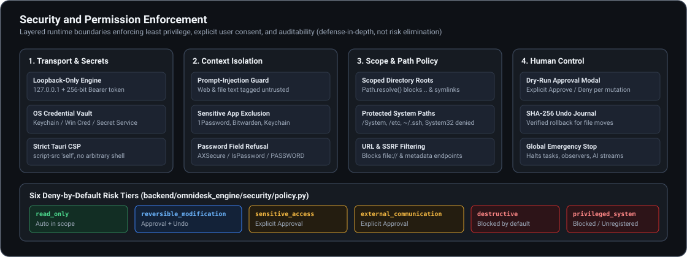

Key controls implemented in the engine and shell:

- **Deny-by-default tool registry**: Every tool declares one of six risk tiers (`read_only`, `reversible_modification`, `sensitive_access`, `external_communication`, `destructive`, `privileged_system`) in `backend/omnidesk_engine/security/policy.py`. Unregistered tools default to `privileged_system` and are blocked.
- **Authenticated loopback IPC**: The local FastAPI server binds exclusively to `127.0.0.1` and validates a per-session 256-bit cryptographically random Bearer token (`OMNIDESK_SESSION_TOKEN`) in constant time (`hmac.compare_digest`), passed only through process environment variables.
- **OS credential vault storage**: Cloud API keys live exclusively in macOS Keychain, Windows Credential Manager, or Linux Secret Service. Keys are never written to `.env`, SQLite, JSON configs, frontend storage, or logs.
- **Scoped paths and protected directories**: All paths are canonicalized with `Path.resolve()` to stop `..` traversal and symlink escapes. Sensitive system and credential directories (`/System`, `/etc`, `/usr`, `/bin`, `/sbin`, `~/.ssh`, `~/.aws`, `~/.gnupg`, `C:\Windows\System32`) are unconditionally denied.
- **Password and sensitive app refusal**: Default exclusions block `1Password`, `Bitwarden`, `Keychain Access`, `KeePassXC`, and sensitive window titles (`password`, `2fa`, `otp`, `banking`, `wallet`), while OS adapters skip password inputs (`AXSecureTextField`, `IsPassword`, `ROLE_PASSWORD_TEXT`).
- **Local-first storage and zero telemetry**: Telemetry is disabled by default (`telemetry_enabled: false`), no analytics SDKs are bundled, and Live Workspace snapshots are strictly manual single-shot actions that never leave your device unless `cloud_screenshot_consent` is explicitly turned on.
- **SHA-256 rollback and Emergency Stop**: Approved file moves write content digests to `operation_journal` for verified Undo, and Emergency Stop immediately cancels active tasks, Teach Mode observers, and streaming AI requests.

Read the full threat model in [SECURITY.md](SECURITY.md) and data retention rules in [docs/PRIVACY.md](docs/PRIVACY.md).

---

## Development Roadmap

OmniDesk `v0.1.0` prioritizes hardware validation and core reliability over speculative release dates:

- **Near-term hardware verification**: Native runtime testing on physical Windows 10/11 (`x64` and `ARM64`), Linux X11 and Wayland (Ubuntu, Fedora, Debian), and Apple Silicon (`arm64`) hosts, including Metal acceleration for local Ollama models and installer packaging checks.
- **Core operator capabilities**: Deeper multi-level accessibility selectors, richer Teach Mode parameter editing and step assertions, improved constrained JSON reliability for compact 0.5B to 7B local models, and strictly opt-in visual element disambiguation for apps with incomplete accessibility trees.
- **Ecosystem, packaging, and quality**: Shareable workflow packs with explicit permission manifests, Apple Developer ID notarization, Windows Authenticode signing, signed Linux checksums, and continued WCAG AA and 8 GB RAM efficiency improvements.

See [ROADMAP.md](ROADMAP.md) for the complete roadmap.

---

## Documentation

| Document | Contents |
| --- | --- |
| [docs/ARCHITECTURE.md](docs/ARCHITECTURE.md) | Process topology, loopback IPC, pipeline state machine, and directory map |
| [docs/AI_PROVIDERS.md](docs/AI_PROVIDERS.md) | Local Ollama configuration, cloud API adapters, fallback priority, and plan validation |
| [docs/INSTALLATION.md](docs/INSTALLATION.md) | Prerequisites, source build instructions, permissions, and sidecar packaging |
| [docs/PLATFORM_SUPPORT.md](docs/PLATFORM_SUPPORT.md) | Verified vs pending hardware capability matrix for macOS, Windows, and Linux |
| [docs/WORKFLOWS.md](docs/WORKFLOWS.md) | Workflow Studio visual DAG editor and Teach Mode recording pipeline |
| [docs/PRIVACY.md](docs/PRIVACY.md) | Local SQLite persistence, zero-telemetry policy, cloud consent, and redaction rules |
| [docs/TROUBLESHOOTING.md](docs/TROUBLESHOOTING.md) | Common startup, Ollama, macOS permission, Playwright, and Wayland fixes |
| [docs/SIGNING_AND_NOTARIZATION.md](docs/SIGNING_AND_NOTARIZATION.md) | Release signing setup for macOS, Windows, and Linux installers |
| [DESIGN.md](DESIGN.md) | Omni Glass material hierarchy, typography, and WCAG AA contrast palette |
| [SECURITY.md](SECURITY.md) | Defense-in-depth controls and private vulnerability disclosure instructions |
| [ROADMAP.md](ROADMAP.md) | Engineering priorities for hardware verification and future milestones |
| [CONTRIBUTING.md](CONTRIBUTING.md) | Engineering guidelines, local test commands, and pull request workflow |
| [CHANGELOG.md](CHANGELOG.md) | Version history starting with `v0.1.0` Developer Preview |

---

## License

OmniDesk is licensed under the [Apache License 2.0](LICENSE). See [docs/LICENSE_DECISION.md](docs/LICENSE_DECISION.md) for the licensing rationale.

Copyright 2026 **NGOPREK DIGITAL**.

## Author

Created and maintained by **Dandi Setiawan** (**NGOPREK DIGITAL**).

- Website: [https://www.dandisetiawan.id/](https://www.dandisetiawan.id/)
- GitHub: [@dandisetiawanco](https://github.com/dandisetiawanco)
- Repository: [https://github.com/dandisetiawanco/Omnidesk](https://github.com/dandisetiawanco/Omnidesk)
