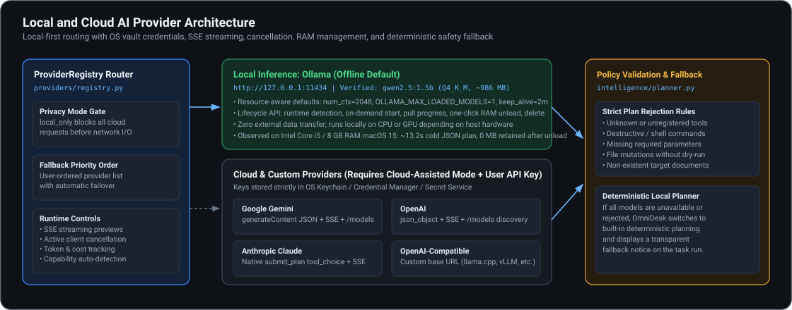

# AI Providers & Local Intelligence

OmniDesk supports both offline local inference and optional cloud AI providers behind a unified, privacy-aware `ProviderRegistry` (`backend/omnidesk_engine/providers/registry.py`).

## Local Inference via Ollama

Local inference runs fully offline through **Ollama** (`http://127.0.0.1:11434`).

### Verified Local Configuration

| Parameter | Verified Development Value |
| --- | --- |
| Runtime | Ollama `v0.40.17` (universal macOS binary) |
| Model | `qwen2.5:1.5b` (1.5B parameters, GGUF `Q4_K_M`) |
| Model Disk Size | ~986 MB (`986,061,892` bytes) |
| Default Context Limit | `num_ctx=2048` on systems with <= 9 GB RAM (`4096` on higher-RAM hosts) |
| Memory Policy | `OLLAMA_MAX_LOADED_MODELS=1`, `OLLAMA_KEEP_ALIVE=2m`, plus one-click **Unload from RAM** |
| Tested Environment | macOS 15.8.3, Intel Core i5-8279U (x86_64, 8 logical cores), 8 GB RAM |
| Observed Behavior | ~13.2s cold structured JSON plan (277 tokens); fast warm streaming; `0 MB` model RAM retained after unload |

*Note: Observed timing reflects CPU inference on an 8 GB Intel macOS laptop and is not a universal benchmark across all hardware.*

### Capabilities Managed Inside OmniDesk

- Automatic local Ollama binary detection across standard install paths (`/usr/local/bin/ollama`, `/opt/homebrew/bin/ollama`, `~/.local/bin/ollama`, `/Applications/Ollama.app/Contents/Resources/ollama`).
- On-demand local runtime startup (`POST /api/providers/ollama/start`).
- In-app model download with progress polling (`POST /api/providers/ollama/pull`, `GET /api/providers/ollama/pull-status`).
- Explicit RAM release (`POST /api/providers/ollama/unload` sending `keep_alive: 0`) and local model deletion.

### Honest Limitations of Compact Local Models

Lightweight 0.5B to 1.5B quantized models run comfortably in 8 GB RAM without a discrete GPU, but they are more prone than frontier cloud models to omitting required tool arguments or combining steps inconsistently on complex prompts. OmniDesk mitigates this structurally:

- Every AI-generated plan passes strict outside-the-model validation in `backend/omnidesk_engine/intelligence/planner.py`.
- Plans containing unregistered tools, destructive commands, file moves without a prior dry-run step, or missing required parameters are automatically rejected.
- When rejected or unreachable, OmniDesk falls back transparently to `local_deterministic_planner` and surfaces a **Planner Fallback Notice** in the Operator view.

## Cloud AI Providers

Live cloud inference requires valid user-provided API credentials stored in your OS credential vault and switching Privacy Mode to **Cloud-assisted** in **Settings**.

| Provider | Structured Planning Mechanism | Dynamic Model Discovery | Streaming & Cancellation | Usage & Cost Estimates |
| --- | --- | --- | --- | --- |
| **Google Gemini** | `generateContent` with `systemInstruction` & `responseMimeType: application/json` | `GET /v1beta/models` | SSE (`streamGenerateContent?alt=sse`) + abort | `usageMetadata` tokens + estimated USD |
| **OpenAI** | `/chat/completions` with `response_format: json_object` | `GET /v1/models` | SSE stream + abort | `usage` tokens + estimated USD |
| **Anthropic Claude** | `/messages` with native `submit_plan` tool schema & `tool_choice` | `GET /v1/models` | SSE `content_block_delta` + abort | `input_tokens` / `output_tokens` + estimated USD |
| **OpenAI-Compatible** | `/chat/completions` against custom base URL (llama.cpp, vLLM, LM Studio, etc.) | `GET /models` | SSE stream + abort | Token counts when returned by server |

## Provider Fallback Priority

Users can reorder provider fallback priority in **Models > Provider Fallback Priority & Live Streaming Test**. If a higher-priority provider is offline, unconfigured, rate-limited (`HTTP 429`), or emits a malformed plan, OmniDesk automatically advances to the next permitted provider and ultimately falls back safely to the deterministic local planner.
