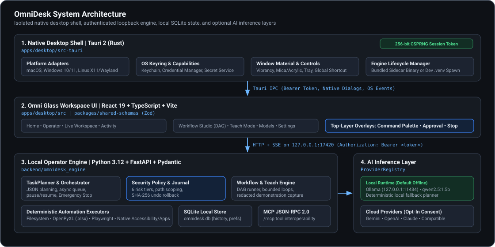
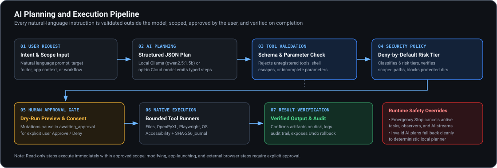
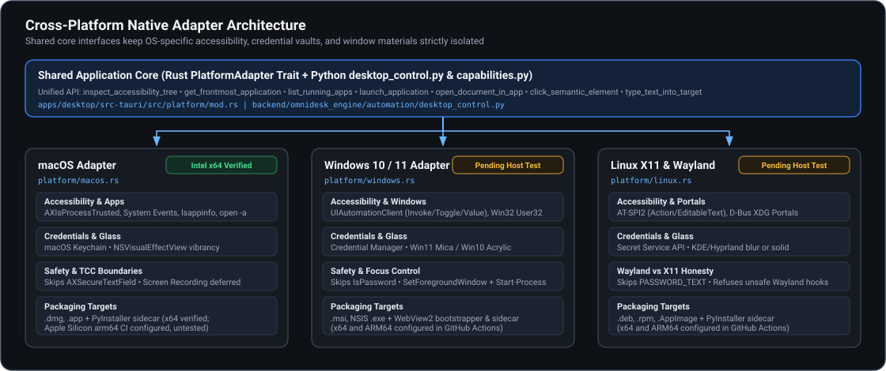
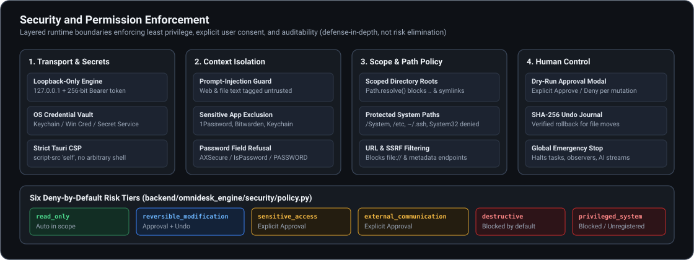

# OmniDesk Architecture

OmniDesk separates its native desktop shell, shared schemas, AI planning layer, security policy boundary, and deterministic automation executors into clearly isolated modules.

## System Topology

OmniDesk runs as two local processes communicating strictly over loopback (`127.0.0.1`):

1. **Tauri 2 Native Shell (`apps/desktop/src-tauri`)**: Manages the native OS window (macOS `NSVisualEffectView`, Windows 11 Mica / Windows 10 Acrylic, Linux compositor or solid fallback), system tray, global shortcut (`CommandOrControl+Shift+Space`), hardware/permission capability discovery, OS secure credential vault, and lifecycle management for the local backend engine. At launch, it generates a 256-bit cryptographically random `OMNIDESK_SESSION_TOKEN` passed via environment variable.
2. **Omni Glass Frontend (`apps/desktop/src`)**: A React 19 + TypeScript + Vite single-page desktop interface communicating with the Rust shell over Tauri IPC and with the local engine via authenticated HTTP/SSE requests (`Authorization: Bearer <token>`). Shared types and Zod contracts live in `packages/shared-schemas`.
3. **Local Operator Engine (`backend/omnidesk_engine`)**: A FastAPI + Pydantic + SQLite engine that handles structured AI planning, strict policy enforcement, bounded asynchronous task execution, SHA-256 operation journaling, Workflow Studio execution, Teach Mode demonstration capture, desktop/file/browser automation, and MCP JSON-RPC 2.0 interoperability.

In development mode (`pnpm dev:desktop`), Tauri spawns `backend/.venv/bin/python`. In packaged release bundles (`scripts/build-sidecar.py` + `tauri.release.conf.json`), Tauri launches a bundled PyInstaller standalone sidecar binary (`omnidesk-engine`) directly so end users do not need Python or Node.js installed.

## AI Planning and Execution Pipeline

Every natural-language request follows a deterministic, auditable state machine:

1. **User Request**: Natural-language instruction, optional scoped directory, or workflow invocation.
2. **AI Planning**: `ProviderRegistry` queries the first permitted, reachable provider (local Ollama by default, or opt-in cloud providers) for a structured JSON plan.
3. **Tool & Schema Validation**: `TaskPlanner` verifies every returned tool name against `TOOL_POLICIES`, validates required parameters, and rejects destructive/unregistered tools or incomplete plans (falling back cleanly to `local_deterministic_planner` with a visible notice).
4. **Security Policy Classification**: Each step receives one of six risk tiers (`read_only`, `reversible_modification`, `sensitive_access`, `external_communication`, `destructive`, `privileged_system`).
5. **Dry-Run & Human Approval**: Modifying, external browser, or native app interaction steps compute a preview and pause in `awaiting_approval` until the user explicitly approves or denies.
6. **Native Execution & Journaling**: Approved mutations re-validate scoped paths and record SHA-256 checksums in `operation_journal`.
7. **Verification & Audit**: Outputs and generated files are verified on disk and persisted to local SQLite (`omnidesk.db`), exposing Undo rollback for reversible file moves.

## Cross-Platform Native Adapter Architecture

Platform-specific logic is isolated behind the `PlatformAdapter` trait (`apps/desktop/src-tauri/src/platform/mod.rs`) and corresponding Python platform branches (`backend/omnidesk_engine/automation/desktop_control.py` and `capabilities.py`). Shared UI and orchestration code never embeds OS-specific shell hacks.

## Security Enforcement Boundaries

## Modular Directory Map

| Path | Responsibility |
| --- | --- |
| `packages/shared-schemas` | TypeScript and Zod contracts shared across frontend and tests |
| `apps/desktop/src` | React 19 UI, Omni Glass 4-tier CSS tokens, views, and dialogs |
| `apps/desktop/src-tauri` | Rust native shell, OS adapters, keyring, vibrancy, tray, sidecar launcher |
| `backend/omnidesk_engine/security` | Policy tiers, path/URL scoping, prompt-injection isolation, credential vault, undo journal |
| `backend/omnidesk_engine/providers` | Ollama, Gemini, OpenAI, Anthropic, and OpenAI-compatible adapters |
| `backend/omnidesk_engine/intelligence` | Structured `TaskPlanner` and async `TaskOrchestrator` |
| `backend/omnidesk_engine/automation` | Filesystem, OpenPyXL `.xlsx`, Markdown, Playwright, native app/accessibility control, opt-in vision |
| `backend/omnidesk_engine/workflows` | Versioned DAG `WorkflowRunner` and `TeachModeEngine` |
| `backend/omnidesk_engine/mcp` | Model Context Protocol (MCP) JSON-RPC 2.0 endpoint |
| `scripts/build-sidecar.py` | Cross-platform PyInstaller sidecar bundler for Tauri release packages |
