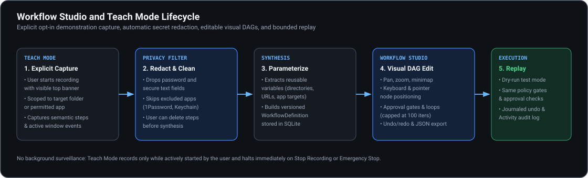

# Workflow Studio & Teach Mode

OmniDesk provides two complementary authoring surfaces for repeatable desktop automation: **Workflow Studio** (a visual node-graph editor) and **Teach Mode** (an explicit demonstration recorder that synthesizes reusable workflows).

## Workflow Studio

Workflow Studio (`apps/desktop/src/views/WorkflowStudioView.tsx` and `backend/omnidesk_engine/workflows/engine.py`) lets users inspect, author, version, dry-run, and execute structured DAG workflows stored in SQLite.

### Implemented Features

- **Interactive visual canvas**: Pan, zoom, minimap overview, pointer dragging, and keyboard node positioning.
- **Editing controls**: Node inspector for parameters and risk metadata, undo/redo stack, version incrementing on save, and portable JSON export.
- **Safety boundaries**:
  - Bounded loops capped strictly at `<= 100` iterations (validated in both Zod schemas and Pydantic models).
  - Explicit human approval gates preserved on every modifying or external node.
  - **Dry-Run Test** mode to validate workflow variables and step policies without moving files or writing artifacts.

## Teach Mode

Teach Mode (`apps/desktop/src/views/TeachModeView.tsx` and `backend/omnidesk_engine/workflows/teach.py`) turns user-led demonstrations into editable Workflow Studio pipelines without silent background surveillance.

### How Teach Mode Works

1. **Explicit start and visible indicator**: Recording only runs after clicking **Start Teaching** and displays a persistent top **Teach Mode Recording** banner across the entire application with an immediate **Stop Recording** control.
2. **Scoped semantic observation**: Captures permitted active-window transitions, scoped directory file events, or manual structured steps (`app_focus`, `file_action`, `browser_navigation`, `ui_semantic_click`, `report_export`).
3. **Automatic privacy filtering**: Password inputs (`is_secure_field`), sensitive window titles, and applications in the user's Excluded Sensitive Applications list are dropped automatically before persistence.
4. **Step review and editing**: Users can inspect recorded steps and remove unwanted events before conversion.
5. **Variable extraction and synthesis**: Converting a session extracts reusable parameters (such as target directories or application names) and saves a versioned workflow directly into Workflow Studio.

*Current scope note: Teach Mode currently synthesizes semantic file, app-focus, browser, and accessibility steps rather than low-level raw coordinate click replay.*
